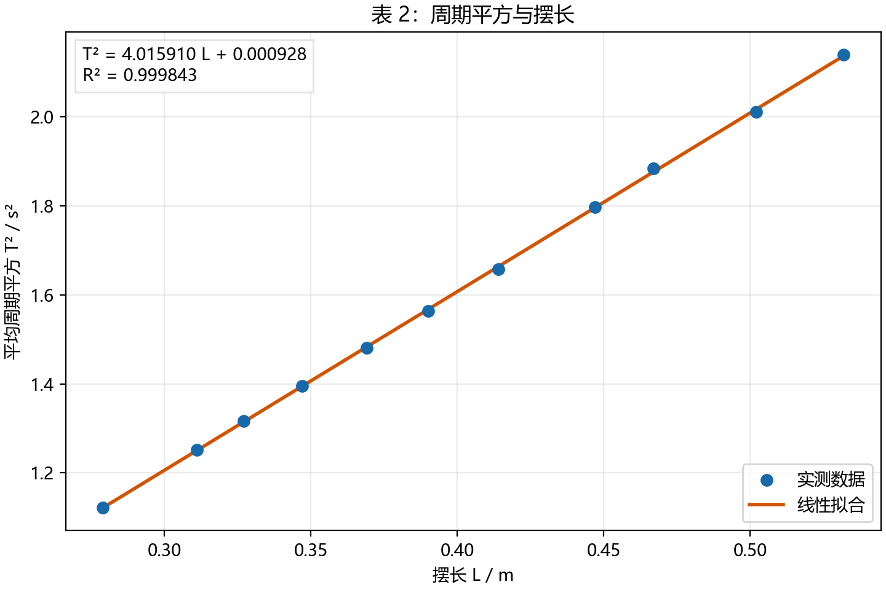
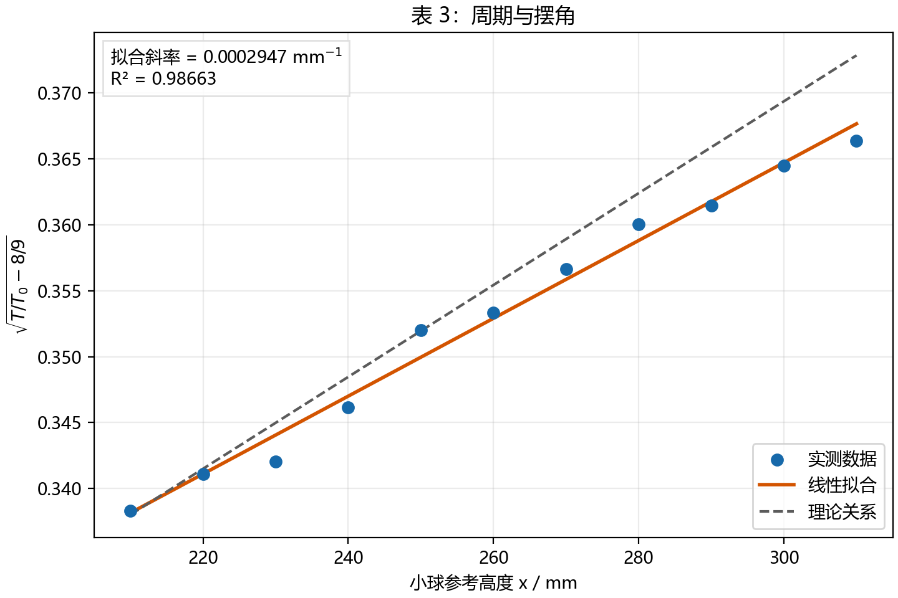
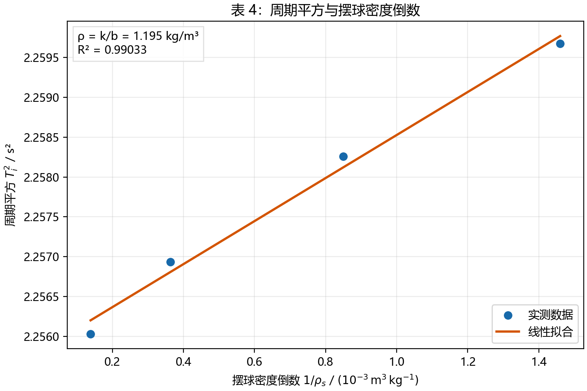

# 单摆法测重力加速度和空气密度：数据测量与分析、思考题

> 数据来源：`data.xlsx`；原理与表格格式依据《单摆法测重力加速度和空气密度-讲义.pdf》和《报告.pdf》。长沙重力加速度参考值取报告所给的 9.791 m/s²。所有拟合均使用未提前取整的六次测量平均值。

## 数据测量与分析

### 1. 误差均分设计与单点测量重力加速度（表 1）

梁夹距 $h_0=13$ mm，梁球距 $h=572$ mm，故摆长 $L=h-h_0=0.559$ m。计时器误差限为 0.00004 s，钢卷尺对摆长的误差限按报告给出的 0.4 mm 处理。

| 序号 | 1 | 2 | 3 | 4 | 5 | 6 | 平均值 |
| --- | --- | --- | --- | --- | --- | --- | --- |
| 周期 $T$/s | 1.49861 | 1.49932 | 1.50010 | 1.49747 | 1.49738 | 1.49741 | 1.498382 |

由 $u_g/g=\sqrt{(u_L/L)^2+(2u_T/T)^2}$，按两项等额分配 0.5% 的目标相对不确定度，得 $u_L/L\leq0.5\%/\sqrt2$、$u_T/T\leq0.5\%/(2\sqrt2)$。设计阶段仅计 B 类不确定度：

- $u_L=0.4/\sqrt3=0.2309$ mm，最小设计摆长 $L_{\min}=65.3$ mm。实际 $L=559$ mm，大于该下限。
- $u_{TB}=0.00004/\sqrt3=0.0000231$ s，直接测一个周期时的最小设计周期 $T_{\min}=0.01306$ s。实际约 1.498 s，计时器分辨率满足要求；此处使用直接周期数据，故无需累积周期数 $N$ 或累计时间 $t$。

实际测量中，周期平均值的 A 类标准不确定度按 $u_{TA}=\sqrt{\sum_i(T_i-\bar T)^2/[n(n-1)]}$ 计算，而不是对偏差直接求和：

$$
u_{TA}=0.0004713\ \mathrm{s},\quad u_{TB}=0.0000231\ \mathrm{s},\quad u_T=\sqrt{u_{TA}^2+u_{TB}^2}=0.0004719\ \mathrm{s}
$$

$$
g=\frac{4\pi^2L}{\bar T^2}=9.8294\ \mathrm{m/s^2},\qquad u_g=g\sqrt{(u_L/L)^2+(2u_T/\bar T)^2}=0.0074\ \mathrm{m/s^2}
$$

结果为 **$g=(9.829\pm0.007)$ m/s²**（标准不确定度，$k=1$）。相对标准不确定度为 **0.075%**，满足 0.5% 的设计指标；相对长沙参考值的偏差为 **+0.392%**。若将 $h$ 与 $h_0$ 视为两次独立卷尺读数，其长度不确定度应改为 $\sqrt2\times0.4/\sqrt3$ mm，结论仍满足设计指标。

### 2. 周期与摆长的关系（表 2）

$h_0=13$ mm，$L=(h-h_0)/1000$ m。每个摆长测 6 次，先求 $\bar T$，再取 $\bar T^2$。

| $h$/mm | $L$/m | T₁/s | T₂/s | T₃/s | T₄/s | T₅/s | T₆/s | $\bar T$/s | $\bar T^2$/s² |
| --- | --- | --- | --- | --- | --- | --- | --- | --- | --- |
| 545 | 0.532 | 1.46255 | 1.46244 | 1.46267 | 1.46314 | 1.46321 | 1.46320 | 1.462868 | 2.139984 |
| 515 | 0.502 | 1.41831 | 1.41826 | 1.41791 | 1.41782 | 1.41820 | 1.41800 | 1.418083 | 2.010960 |
| 480 | 0.467 | 1.37308 | 1.37196 | 1.37274 | 1.37296 | 1.37314 | 1.37325 | 1.372855 | 1.884731 |
| 460 | 0.447 | 1.33989 | 1.34112 | 1.34084 | 1.34095 | 1.34008 | 1.34065 | 1.340588 | 1.797177 |
| 427 | 0.414 | 1.28791 | 1.28812 | 1.28796 | 1.28706 | 1.28802 | 1.28700 | 1.287678 | 1.658115 |
| 403 | 0.390 | 1.25059 | 1.25063 | 1.25065 | 1.25015 | 1.25057 | 1.25017 | 1.250460 | 1.563650 |
| 382 | 0.369 | 1.21681 | 1.21716 | 1.21697 | 1.21642 | 1.21685 | 1.21694 | 1.216858 | 1.480744 |
| 360 | 0.347 | 1.18102 | 1.18156 | 1.18105 | 1.18109 | 1.18083 | 1.18118 | 1.181122 | 1.395048 |
| 340 | 0.327 | 1.14759 | 1.14765 | 1.14726 | 1.14749 | 1.14789 | 1.14693 | 1.147468 | 1.316684 |
| 324 | 0.311 | 1.11870 | 1.11859 | 1.11871 | 1.11849 | 1.11847 | 1.11862 | 1.118597 | 1.251259 |
| 292 | 0.279 | 1.05931 | 1.05934 | 1.05903 | 1.05890 | 1.05886 | 1.05896 | 1.059067 | 1.121622 |

最小二乘拟合（$L$ 用 m）：$\bar T^2=(4.015910\ \mathrm{s^2/m})L+(0.000928\ \mathrm{s^2})$，$R^2=0.999843$。由斜率得 $g=4\pi^2/k=9.8305$ m/s²，与长沙参考值的相对偏差为 **+0.403%**。截距接近零；未强制拟合线过原点，以便观察固定偏差。该组摆长 279–532 mm 均短于表 1 的 559 mm，与讲义建议“取比初始摆长更长”的步骤不一致，但不影响按实测数据进行本次拟合。

### 3. 周期与摆角的关系（表 3）

$h_0=13$ mm，$h=552$ mm，$L=539$ mm，$x_0=196.5$ mm，使用原始数据给出的 $T_0=1.47838$ s。由 $\sin^2(\theta/2)=(x-x_0)/(2L)$，令 $y=\sqrt{\bar T/T_0-8/9}$。讲义的四次项近似给出 $y=3x/(16L)+[1/3-3x_0/(16L)]$。

| $x$/mm | T₁/s | T₂/s | T₃/s | T₄/s | T₅/s | T₆/s | $\bar T$/s | $y$ |
| --- | --- | --- | --- | --- | --- | --- | --- | --- |
| 210 | 1.48264 | 1.48181 | 1.48232 | 1.48079 | 1.48641 | 1.48605 | 1.483337 | 0.338325 |
| 220 | 1.48755 | 1.48551 | 1.48497 | 1.48525 | 1.48864 | 1.48491 | 1.486138 | 0.341114 |
| 230 | 1.48981 | 1.48810 | 1.48696 | 1.48623 | 1.48654 | 1.48497 | 1.487102 | 0.342068 |
| 240 | 1.49357 | 1.49205 | 1.49234 | 1.49027 | 1.48961 | 1.48972 | 1.491260 | 0.346155 |
| 250 | 1.49631 | 1.49870 | 1.49847 | 1.49644 | 1.49741 | 1.49637 | 1.497283 | 0.351991 |
| 260 | 1.50136 | 1.49925 | 1.49966 | 1.49822 | 1.49533 | 1.49816 | 1.498663 | 0.353314 |
| 270 | 1.50402 | 1.50445 | 1.50663 | 1.49918 | 1.49975 | 1.49884 | 1.502145 | 0.356632 |
| 280 | 1.50772 | 1.50555 | 1.50417 | 1.50667 | 1.50694 | 1.50347 | 1.505753 | 0.360037 |
| 290 | 1.51149 | 1.50890 | 1.50574 | 1.50450 | 1.50873 | 1.50411 | 1.507245 | 0.361436 |
| 300 | 1.51445 | 1.51472 | 1.51417 | 1.50815 | 1.50635 | 1.50516 | 1.510500 | 0.364469 |
| 310 | 1.51861 | 1.51889 | 1.51759 | 1.50876 | 1.50614 | 1.50532 | 1.512552 | 0.366368 |

实测拟合为 $y=(0.0002947\ \mathrm{mm^{-1}})x+0.276286$，$R^2=0.98663$。理论斜率 $k_0=0.0003479$ mm⁻¹、截距 $b_0=0.264978$；实测斜率比理论值低 **15.3%**，截距高 **4.3%**。周期随 $x$ 增大而增大，趋势与有限摆角修正一致，但斜率并未严格符合近似式。
按 $\theta=\arccos[1-(x-x_0)/L]$ 换算，本组初始角约为 **12.9°–37.9°**。较大摆角下，四次项截断、释放状态和振幅在计时过程中的衰减都可能造成偏差，因此只能说数据支持周期随摆角增大的趋势，不能声称精确验证了理论系数。

### 4. 测量空气密度（表 4）

已直接测得各摆球的 $T_i$，因此按要求删去 $t_i$ 列，也不假定累计振动次数。原始文件只有 4 个摆球的数据，第 5 个空行不参与拟合。按球体模型计算 $V=\pi d^3/6$，$\rho_{si}=m_i/V_i$。

| 摆球 | $m_i$/g | $d_i$/mm | $V_i$/cm³ | $\rho_{si}$/kg·m⁻³ | $1/\rho_{si}$/m³·kg⁻¹ | $T_i$/s | $T_i^2$/s² |
| --- | --- | --- | --- | --- | --- | --- | --- |
| 1 | 29.75 | 19.9 | 4.126272 | 7209.90 | 0.000138698 | 1.50201 | 2.25603404 |
| 2 | 11.54 | 20.0 | 4.188790 | 2754.97 | 0.000362980 | 1.50231 | 2.25693534 |
| 3 | 2.70 | 19.6 | 3.942456 | 684.85 | 0.001460169 | 1.50322 | 2.25967037 |
| 4 | 4.57 | 19.5 | 3.882419 | 1177.10 | 0.000849545 | 1.50275 | 2.25825756 |

以 $X=1/\rho_s$（m³/kg）、$Y=T_i^2$（s²）作线性拟合，得到 $Y=kX+b$，其中 $k=2.696004$ s²·kg·m⁻³，$b=2.25582945$ s²，$R^2=0.99033$。因此 **$\rho_{air}=k/b=1.195$ kg/m³**。
仅从 4 个拟合点的残差估计，$\rho_{air}$ 的标准误差约为 0.084 kg/m³；这不包含质量、直径、摆长、不同球安装位置以及 $T_i$ 的测量不确定度，不能当作完整测量不确定度。四个周期仅相差约 1.21 ms，系统偏差足以明显改变斜率。讲义的一阶近似要求 $\rho_{air}/\rho_s\ll1$，本组最轻密度球的比值约 0.0017，形式上满足该条件。

## 思考题

### 1. 为什么单摆周期与摆球质量无关？本实验中是否可用任意质量的球？

理想单摆的切向运动方程是 $mL\ddot\theta=-mg\sin\theta$。两边约去 $m$，小角度下得到 $\ddot\theta+(g/L)\theta=0$，故 $T=2\pi\sqrt{L/g}$，与质量无关。实际实验不能任取质量：球太轻时空气浮力、阻力和摆线质量相对影响变大；球太重可能使摆线伸长、夹具滑动。还应使球尺寸相对摆长足够小，并保证光电门能稳定触发。本实验测空气密度正是利用不同密度球的非理想修正。

### 2. 若摆线有质量不可忽略，周期公式应如何修正？

将质量为 $M$ 的摆球视为距悬点 $L$ 的质点，将长度 $l$、质量 $m_l$ 的均匀摆线视为细杆。小角度下总转动惯量为 $I=ML^2+m_l l^2/3$，重力回复力矩系数为 $g(ML+m_l l/2)$，故

$$T=2\pi\sqrt{\frac{ML^2+m_l l^2/3}{g(ML+m_l l/2)}}.$$

当摆线延伸到球心、$l\approx L$ 时，$T\approx2\pi\sqrt{\frac{L}{g}\frac{M+m_l/3}{M+m_l/2}}$。这说明不能简单把摆线质量全部加到摆球上；摆线各部分到悬点的距离不同，应按物理摆的转动惯量和质心位置修正。
