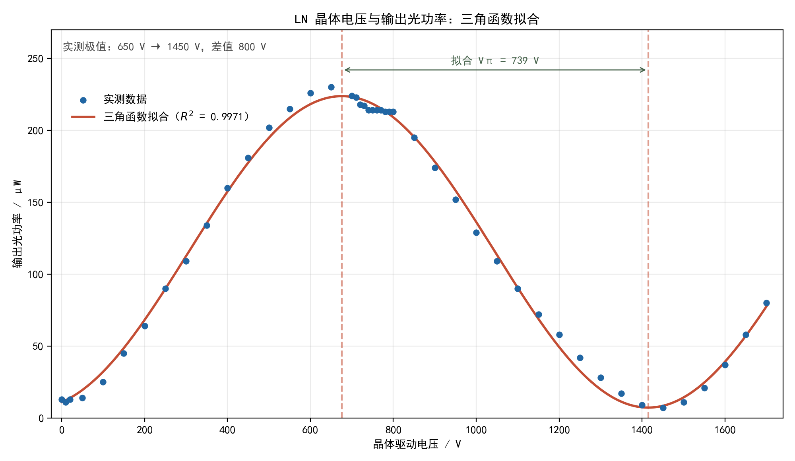

# 电光效应实验报告

## 数据测量与分析

### 2. LN 晶体的电光特性和参数测量

#### （1）利用偏振光特性测量 LN 晶体的电光特性

电压与输出光功率的实测值如下（数据来自 `data.xlsx` 的 Sheet1）：

| 电压 / V | 功率 / μW | 电压 / V | 功率 / μW | 电压 / V | 功率 / μW |
| ---: | ---: | ---: | ---: | ---: | ---: |
| 0 | 13 | 550 | 215 | 1050 | 109 |
| 10 | 11 | 600 | 226 | 1100 | 90 |
| 20 | 13 | 650 | 230 | 1150 | 72 |
| 50 | 14 | 700 | 224 | 1200 | 58 |
| 100 | 25 | 710 | 223 | 1250 | 42 |
| 150 | 45 | 720 | 218 | 1300 | 28 |
| 200 | 64 | 730 | 217 | 1350 | 17 |
| 250 | 90 | 740 | 214 | 1400 | 9 |
| 300 | 109 | 750 | 214 | 1450 | 7 |
| 350 | 134 | 760 | 214 | 1500 | 11 |
| 400 | 160 | 770 | 214 | 1550 | 21 |
| 450 | 181 | 780 | 213 | 1600 | 37 |
| 500 | 202 | 790 | 213 | 1650 | 58 |
|  |  | 800 | 213 | 1700 | 80 |
|  |  | 850 | 195 |  |  |
|  |  | 900 | 174 |  |  |
|  |  | 950 | 152 |  |  |
|  |  | 1000 | 129 |  |  |

功率在 **650 V** 时达到所测最大值 **230 μW**，随后下降，在 **1450 V** 时达到相邻的最小值 **7 μW**。按照报告模板规定的极大值与相邻极小值电压差，半波电压为

$$
V_\pi=(1450-650)\,\mathrm{V}=\boxed{800\,\mathrm{V}}.
$$

图中的原始数据仅以散点表示，平滑曲线由三角函数模型 $P(V)=C+A\cos\left(\frac{\pi(V-V_{\max})}{V_{\pi,\mathrm{fit}}}\right)$ 最小二乘拟合得到。拟合参数约为 $C=115.49\,\mu\mathrm{W}$、$A=108.28\,\mu\mathrm{W}$、$V_{\max}=675.94\,\mathrm{V}$、$V_{\pi,\mathrm{fit}}=738.77\,\mathrm{V}$，$R^2=0.9971$。拟合曲线的相邻极大与极小位置约为 676 V 和 1415 V。下文依照报告模板采用**实测极值差 800 V**计算电光系数；拟合值作为曲线模型的独立参考。

利用模板给出的 $\lambda=650\,\mathrm{nm}$、$n_o=2.26$、$h=5\,\mathrm{mm}$、$L=30\,\mathrm{mm}$，求得 LN 晶体电光系数

$$
\begin{aligned}
\gamma_{22}
&=\frac{\lambda}{2n_o^3V_\pi}\frac{h}{L}\\
&=\frac{650\times10^{-9}\,\mathrm{m}}{2(2.26)^3(800\,\mathrm{V})}\frac{5}{30}\\
&=\boxed{5.87\times10^{-12}\,\mathrm{m/V}}\\
&=\boxed{5.87\,\mathrm{pm/V}}.
\end{aligned}
$$

消光比取本次扫描的最大、最小实测功率：

$$
M=\frac{P_{\max}}{P_{\min}}=\frac{230}{7}=\boxed{32.9}.
$$

LN 晶体透过率按指导书须在**取下晶体、调节检偏器至输出最大**时另测 $P_0$。原始数据没有该测量值，这里暂取**估计值 $P_0=320\,\mu\mathrm{W}$**，于是

$$
T=\frac{P_{\max}}{P_0}=\frac{230}{320}=0.71875\approx\boxed{71.9\%}.
$$

这一估计值的量级可由晶体两个空气界面的反射作粗略检查：取 $n_o=2.26$，单界面垂直入射反射率约为 $R=[(n_o-1)/(n_o+1)]^2=0.149$，忽略吸收、多次反射等因素时，两界面透射率约为 $(1-R)^2=0.724$。这与上面的 71.9% 接近，但 **$P_0=320\,\mu\mathrm{W}$ 并非实测值，71.9% 也只是估算透过率**，不能作为正式测量结果。指导书中的激光器标称功率 4 mW 不是该位置的 $P_0$。

曲线从低电压的近暗态升至亮态，再回到近暗态，符合交叉偏振器下输出功率随电压周期变化的预期。低电压附近的局部最小值为 10 V、11 μW，与 1450 V 的最小值不相同，说明实测曲线存在偏置或漂移。实测极值差与三角函数拟合值相差约 61 V，提示仅靠离散测点判定极值电压有一定误差。

## 思考题

**1. 两种不同测量半波电压的方法各有什么优缺点？**

**偏振光功率扫描法：**逐步改变直流电压并记录输出光功率，从曲线相邻极大、极小值的电压差求半波电压。优点是原理直观，可同时观察完整的电光调制特性，并由功率数据计算消光比。缺点是需要逐点测量，耗时较长；电压步长、光路漂移、激光功率波动和极值附近较平缓的曲线都会影响极值电压的判定。

**倍频失真法：**给晶体施加交流调制，并改变直流偏压；在示波器上找出相邻两次出现倍频失真的静态工作点，其偏压差即为半波电压。优点是无需逐点绘制功率曲线，寻找工作点较快，也可直接观察调制波形。缺点是需要信号驱动、光电接收和示波器；倍频是否明显依赖调制幅度、信噪比和波形判断，因而工作点读数可能带有主观误差。

在两种方法中，都应保持光路、偏振器角度和光源状态稳定，并读取**相邻同类工作点**之间的电压差；倍频法测得的具体电压须以示波器观察记录为准。
